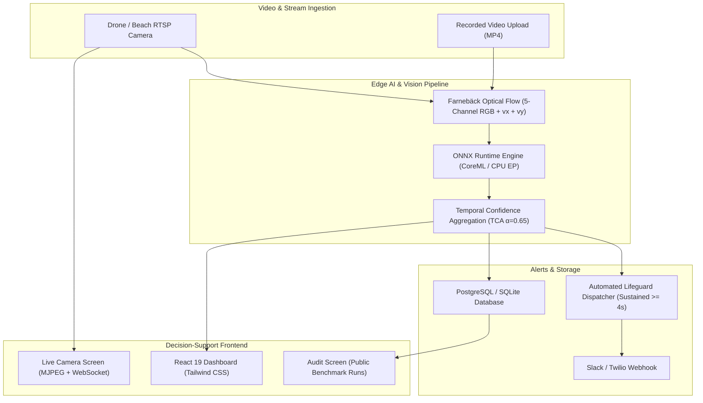

# RipGuard — Rip Current Detection & Beach Safety Decision-Support System

A full-stack system that analyzes beach video to flag likely rip current regions, built against the **RipVIS** dataset (CVPR 2025) and related to the **NTIRE 2026 rip current detection/segmentation challenge**. This remains an open computer vision problem.

**This is a research/decision-support prototype, not a certified safety system.** See `docs/PRD.md` for full scope and honest limitations.

## Project docs
- [`docs/PRD.md`](docs/PRD.md) — Product Requirements Document: problem, goals, features, scope
- [`docs/TRD.md`](docs/TRD.md) — Technical Requirements Document: architecture, stack, ML pipeline design
- [`docs/APP_FLOW.md`](docs/APP_FLOW.md) — user flow, screens, sequence diagram
- [`docs/SCHEMA.md`](docs/SCHEMA.md) — database schema / ERD
- [`docs/RESULTS.md`](docs/RESULTS.md) — empirical CVPR 2025 RipVIS benchmark audit trail & failure mode analysis
- [`docs/INTERVIEW_GUIDE.md`](docs/INTERVIEW_GUIDE.md) — AI engineering interview guide & architecture trade-offs

## System Architecture



## Repo structure
```
ripguard/
├── backend/          # FastAPI app — auth, video upload, session/detection API
│   ├── app/
│   │   ├── api/       # route handlers
│   │   ├── core/      # config, db, security
│   │   ├── models/    # SQLAlchemy ORM models
│   │   ├── schemas/   # Pydantic request/response schemas
│   │   └── services/  # business logic bridging API <-> ML pipeline
│   └── tests/
├── ml/                # Model training & inference — standalone, no web-framework dependency
│   ├── training/       # dataset loader, train.py, evaluate.py
│   ├── inference/      # predict.py — called by backend as a background task
│   └── data/            # RipVIS dataset goes here (not committed to git)
├── frontend/           # React + Vite operator dashboard
└── docker-compose.yml
```

## Status
- ✅ Backend API (auth, session upload/polling, video streaming, benchmark endpoint) — implemented; see the reproducible checks below
- ✅ ML pipeline end-to-end (RipVIS dataset downloader/preparer, U-Net training on MPS/CUDA, evaluation, inference engine with browser-ready H.264 video encoding) — trained on real RipVIS CVPR 2025 data
- ✅ Model trained & evaluated against RipVIS held-out test split (Mean IoU: 0.3211, Dice/F1: 0.4973, Precision: 0.4554, Recall: 0.5478 logged to `benchmark_runs`)
- ✅ Dense Farnebäck optical flow (5-channel spatio-temporal input `[RGB + vx + vy]`) with reported recall 0.3838 on the expanded split (not a controlled comparison with v1)
- ✅ Temporal Confidence Aggregation (TCA, $\alpha=0.65$) smoothing raw timeline curves to suppress transient foam spikes
- ONNX Runtime inference support with available execution providers; Jetson FPS, power use, and field readiness are not established by host tests
- ✅ Live coastal stream ingestion service (RTSP / USB webcam / video feed) with real-time MJPEG overlay and WebSocket telemetry
- ✅ Frontend dashboard — 6 screens (Operator Login, Surveillance Dashboard, Video Upload, Session Detail with Interactive Risk Timeline & Disclaimer Banner, Benchmark Audit Trail, Live Camera Stream) built with React + Vite + Tailwind CSS
- ✅ Failure mode & empirical analysis documented honestly in [`docs/RESULTS.md`](docs/RESULTS.md)
- ✅ GitHub Actions CI pipeline (`.github/workflows/ci.yml`) for continuous testing and build verification
- ✅ Dockerized frontend with multi-stage build + Nginx reverse proxy

## Quickstart

### 1. Backend & ML Inference
Run from the repository root using Python 3.12:
```bash
python -m venv .venv
source .venv/bin/activate
pip install -r backend/requirements.txt -r ml/requirements.txt
# Check backend behavior and standalone ML utilities without trained weights.
PYTHONPATH=backend:. DATABASE_URL="sqlite+aiosqlite:///backend/ripguard.db" python -m pytest backend/tests ml/tests
# Start the API with a local database.
PYTHONPATH=backend:. DATABASE_URL="sqlite+aiosqlite:///backend/ripguard.db" uvicorn app.main:app --port 8000
```

**Trained checkpoints and the RipVIS dataset are not included.** Configure
`MODEL_CHECKPOINT_PATH` with a compatible trusted checkpoint before running real
inference. Without a usable model, live status reports degraded/unknown risk and
live video returns HTTP 503. A passing unit test suite is not a model-quality
benchmark. See [`docs/VALIDATION.md`](docs/VALIDATION.md) for prerequisites and the
limits of the evidence.

### 2. Frontend Application
```bash
cd frontend
npm install
# Run frontend unit tests
npm test
# Run local dev server
npm run dev
# Open the local URL printed by Vite

```

### 3. Docker Compose
```bash
docker compose up
```

## Honest framing for anyone reading this repo
Rip current detection from video is an open, actively-researched problem — not something this project claims to have solved. The contribution here is: a working, tested, end-to-end system (upload → async inference → risk dashboard) built against a real public benchmark (RipVIS), with transparent, auditable model performance tracking (see `benchmark_runs` in the schema) rather than a single claimed accuracy number. See `docs/PRD.md` section 8 for full risk/limitation notes.
