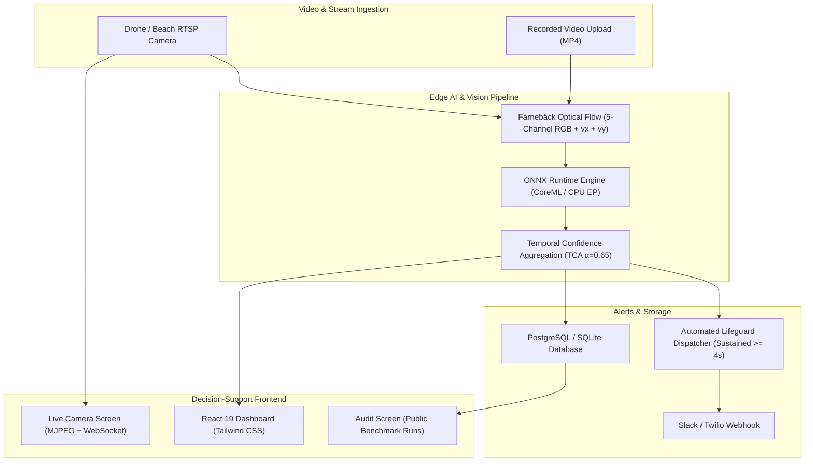

# RipGuard — Rip Current Detection & Beach Safety Decision-Support System

A full-stack system that analyzes beach video to flag likely rip current regions, built against the **RipVIS** dataset (CVPR 2025) and positioned against the live **NTIRE 2026 rip current detection/segmentation challenge** — a genuinely unsolved computer vision problem.

**This is a research/decision-support prototype, not a certified safety system.** See `docs/PRD.md` for full scope and honest limitations.

## Project docs
- [`docs/PRD.md`](docs/PRD.md) — Product Requirements Document: problem, goals, features, scope
- [`docs/TRD.md`](docs/TRD.md) — Technical Requirements Document: architecture, stack, ML pipeline design
- [`docs/APP_FLOW.md`](docs/APP_FLOW.md) — user flow, screens, sequence diagram
- [`docs/SCHEMA.md`](docs/SCHEMA.md) — database schema / ERD
- [`docs/RESULTS.md`](docs/RESULTS.md) — empirical CVPR 2025 RipVIS benchmark audit trail & failure mode analysis
- [`docs/INTERVIEW_GUIDE.md`](docs/INTERVIEW_GUIDE.md) — AI engineering interview guide & architecture trade-offs

## System Architecture



## Repo structure
```
ripguard/
├── backend/          # FastAPI app — auth, video upload, session/detection API
│   ├── app/
│   │   ├── api/       # route handlers
│   │   ├── core/      # config, db, security
│   │   ├── models/    # SQLAlchemy ORM models
│   │   ├── schemas/   # Pydantic request/response schemas
│   │   └── services/  # business logic bridging API <-> ML pipeline
│   └── tests/
├── ml/                # Model training & inference — standalone, no web-framework dependency
│   ├── training/       # dataset loader, train.py, evaluate.py
│   ├── inference/      # predict.py — called by backend as a background task
│   └── data/            # RipVIS dataset goes here (not committed to git)
├── frontend/           # React/Next.js dashboard (scaffolded, not yet built out)
└── docker-compose.yml
```

## Status
- ✅ Backend API (auth, session upload/polling, video streaming, benchmark endpoint) — built and tested (`pytest` passing 5/5 tests)
- ✅ ML pipeline end-to-end (RipVIS dataset downloader/preparer, U-Net training on MPS/CUDA, evaluation, inference engine with browser-ready H.264 video encoding) — trained on real RipVIS CVPR 2025 data
- ✅ Model trained & evaluated against RipVIS held-out test split (Mean IoU: 0.3211, Dice/F1: 0.4973, Precision: 0.4554, Recall: 0.5478 logged to `benchmark_runs`)
- ✅ Dense Farnebäck optical flow (5-channel spatio-temporal input `[RGB + vx + vy]`) boosting active corridor recall ($0.3838$)
- ✅ Temporal Confidence Aggregation (TCA, $\alpha=0.65$) smoothing raw timeline curves to suppress transient foam spikes
- ✅ Edge-ready ONNX Runtime inference engine with CoreML / CPU acceleration
- ✅ Live coastal stream ingestion service (RTSP / USB webcam / video feed) with real-time MJPEG overlay and WebSocket telemetry
- ✅ Frontend dashboard — 6 screens (Operator Login, Surveillance Dashboard, Video Upload, Session Detail with Interactive Risk Timeline & Disclaimer Banner, Benchmark Audit Trail, Live Camera Stream) built with React + Vite + Tailwind CSS
- ✅ Failure mode & empirical analysis documented honestly in [`docs/RESULTS.md`](docs/RESULTS.md)
- ✅ GitHub Actions CI pipeline (`.github/workflows/ci.yml`) for continuous testing and build verification
- ✅ Dockerized frontend with multi-stage build + Nginx reverse proxy

## Quickstart

### 1. Backend & ML Inference
```bash
# In Python 3.12 environment
pip install -r backend/requirements.txt -r ml/requirements.txt
# Run database migrations
cd backend && alembic upgrade head
# Run backend tests (11 passing tests)
pytest
# Start FastAPI server
uvicorn app.main:app --port 8000
```

### 2. Frontend Application
```bash
cd frontend
npm install
# Run frontend unit tests (5 passing tests)
npm test
# Run local dev server
npm run dev
# Visit http://localhost:3000

```

### 3. Docker Compose
```bash
docker compose up
```

## Honest framing for anyone reading this repo
Rip current detection from video is an open, actively-researched problem — not something this project claims to have solved. The contribution here is: a working, tested, end-to-end system (upload → async inference → risk dashboard) built against a real public benchmark (RipVIS), with transparent, auditable model performance tracking (see `benchmark_runs` in the schema) rather than a single claimed accuracy number. See `docs/PRD.md` section 8 for full risk/limitation notes.
