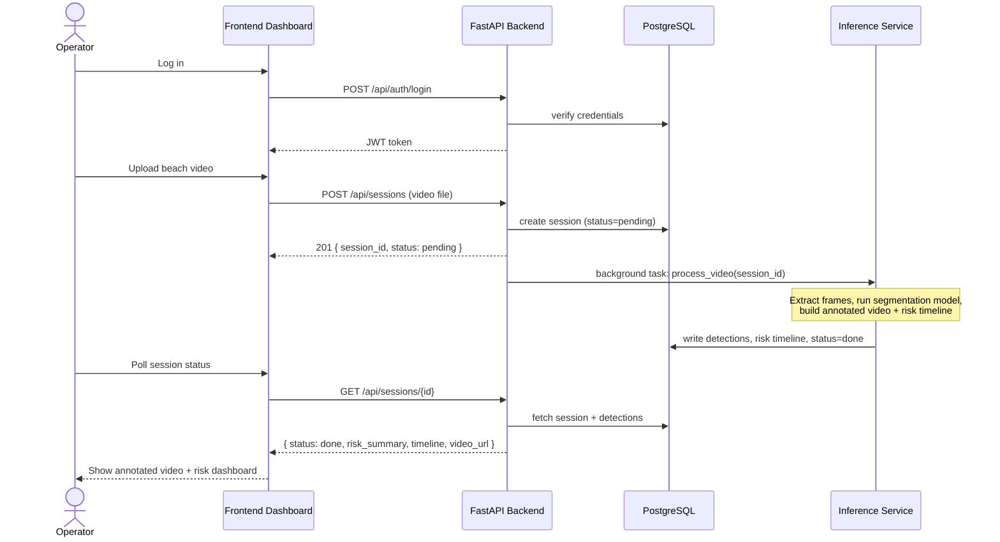

# App Flow — RipGuard

## 1. Primary User Journey: Analyze a Beach Video

## 2. Screens

### Screen 1 — Login
Standard email/password login. JWT stored client-side for subsequent requests.

### Screen 2 — Dashboard (Session List)
- Table of past analysis sessions: filename, date, overall risk level, status.
- "New Analysis" button → upload flow.
- Filter by date range / risk level.

### Screen 3 — Upload / New Analysis
- Drag-and-drop or file picker for video upload.
- Optional metadata: beach/camera location name (free text for v1, no real camera integration).
- On submit: immediately navigate to the session detail screen in "processing" state.

### Screen 4 — Session Detail (the core screen)
- Video player showing the **annotated** output (mask overlay on detected rip current regions).
- Risk timeline below the video — a horizontal strip showing confidence over time, clickable to jump to that point in the video.
- Summary card: overall risk level (Low/Medium/High — derived from max or sustained confidence), number of high-confidence detection windows.
- **Persistent disclaimer banner**: "This is a research prototype and decision-support aid, not a certified safety system. Always rely on trained lifeguard judgment."

### Screen 5 — Benchmark / Model Performance
- Shows the model's IoU/F1/precision/recall on the RipVIS test set.
- Framed honestly: "Current model performance on the RipVIS benchmark" with a short note on what the numbers mean and their limitations.
- This screen exists specifically to make the resume/research value of the project visible and auditable, not just the product UI.

## 3. States & Edge Cases

- **Processing takes a while:** session detail screen shows a processing/progress state while `status=pending` or `processing`; frontend polls every few seconds.
- **Processing failure:** session shows `status=failed` with the error message surfaced (not swallowed).
- **Low-confidence video (model unsure throughout):** dashboard should show this honestly as "no high-confidence detections" rather than forcing a verdict — absence of a flag is not the same as "confirmed safe."
