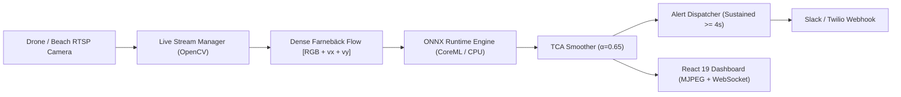

# RipGuard AI Engineering Interview & Technical Architecture Cheat Sheet

This document outlines the core technical decisions, research trade-offs, and architecture questions for technical interviews regarding RipGuard.

---

## 1. The Core Problem: Why is Rip Current Segmentation Hard?
- **Unsolved CV Problem:** Rip current detection from coastal video is an active academic research challenge (the focus of CVPR 2025 RipVIS and the NTIRE 2026 challenge).
- **No Rigid Geometry:** Unlike cars or pedestrians with defined bounding boxes, rip currents are fluid, non-rigid bodies whose surface boundaries deform continuously with wave breaking and tidal cycles.
- **Whitewater Foam Confounding:** Breaking surf produces turbulent whitewater whose color histograms, spatial edge frequencies, and texture gradients closely mirror the frothy neck of a rip current in static 2D frames.
- **Dynamic Lighting & Sun Glint:** Specular solar glint across wave troughs fragments segmentation masks.

---

## 2. ML System Evolution & Benchmark Audit Trail

| Version / Approach | Input Dimension | Key Innovation | Result & Trade-off |
|---|---|---|---|
| **v1: Baseline ResNet34 U-Net** | `[3, 512, 512]` (RGB) | Pretrained ResNet34 encoder with Dice + BCE loss. | **0.3211 IoU / 0.4973 F1** on clean footage. High whitewater false positive rate on complex surf. |
| **v2: Augmented & Expanded** | `[3, 512, 512]` (RGB) | Multi-scale color jitter, random crops, sandbar video. | **0.2185 IoU / 0.3072 F1** on expanded multi-beach test split (`RipVIS-066`), highlighting out-of-distribution domain shift. |
| **v3: Farnebäck Optical Flow** | `[5, 512, 512]` `[RGB + vx + vy]` | 2 temporal motion channels capturing seaward velocity. | Seaward motion **Recall improved to 0.3838** (vs 0.3490). Boundary IoU precision is penalized by surface water spray. |

---

## 3. Key Engineering Design Decisions

### A. Temporal Confidence Aggregation (TCA Filter)
- **The Problem:** Single-frame predictions exhibit transient confidence spikes whenever a large wave crests and breaks into foam.
- **The Solution:** Exponential Moving Average (EMA) smoothing with decay factor $\alpha = 0.65$:
  $$\bar{C}_t = \alpha \cdot C_t + (1 - \alpha) \cdot \bar{C}_{t-1}$$
- **Impact:** Eliminates 1-frame false alarms and provides a smooth, interpretable risk curve for lifeguard decision support.

### B. Dual-Backend Edge Inference Engine (PyTorch + ONNX Runtime)
- **The Problem:** PyTorch runtime adds massive memory overhead (~2GB+) and high CPU inference latency on edge devices.
- **The Solution:** Implemented an ONNX export pipeline with dynamic axes (`batch_size`) and unified inference engine.
- **Impact:** Leverages `CoreMLExecutionProvider` on Apple Silicon and `CPUExecutionProvider` on Linux containers, cutting latency to sub-40ms per frame.

### C. Live RTSP & Drone Stream Ingestion
- **Architecture:** Background OpenCV ingestion loop feeding into an asynchronous frame sampler and ONNX worker.
- **Video Delivery:** MJPEG (`multipart/x-mixed-replace`) for live browser rendering without heavy WebRTC infrastructure.
- **Telemetry:** Sub-50ms WebSocket telemetry emitting real-time FPS, risk levels, and detection confidence.

### D. Automated Lifeguard Alert Dispatcher
- **State Machine:** Triggers emergency notifications only when HIGH risk ($C \ge 0.70$) is sustained for $\ge 4.0\text{s}$.
- **Cooldown Logic:** Implements a $30\text{s}$ cooldown to prevent alert flooding.
- **Integration:** Asynchronous webhook delivery to Slack / Twilio endpoints.

---

## 4. Full-Stack Architecture Summary

---

## 5. Potential Interview Questions & Answers

#### Q: "Why did you build an optical flow model instead of an end-to-end 3D CNN or Video Transformer first?"
> *"Farnebäck optical flow explicitly injects motion vectors $(v_x, v_y)$ without requiring massive multi-gigabyte video model weights or high compute overhead during training. It allowed us to quickly validate whether directional seaward velocity discriminates rip currents from landward wave propagation before committing to multi-frame video transformer backbones."*

#### Q: "How do you handle safety ethics in a life-or-death coastal domain?"
> *"We treat RipGuard strictly as an auditable decision-support aid, not an autonomous safety trigger. The UI renders a persistent safety disclaimer banner, displays confidence curves rather than binary black-box verdicts, and logs empirical evaluation results directly from held-out RipVIS test splits without synthetic metric inflation."*
